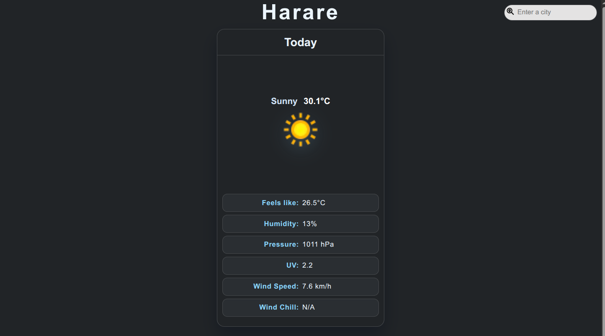

# WeatherWizard 🌦️

Search any city and get current conditions plus a multi-day forecast.

**[Live demo →](https://weather-app-td-95f5.vercel.app)**

## Features
- Current temperature, feels-like, humidity, pressure, UV, wind and wind chill
- Multi-day forecast
- Clear error handling for invalid cities and service outages
- Accessible UI (ARIA live regions, keyboard-friendly search)

## How it works
Browser → `weather.php` (PHP endpoint) → WeatherAPI.com

The API key lives only on the server in an environment variable, so it is
never exposed to the browser.

## Tech stack
PHP, Composer (PSR-4), Guzzle, vanilla JavaScript, HTML/CSS, Docker, Vercel

## Run locally
1. `git clone https://github.com/tadiwanashedombe/weather-app.git`
2. `composer install`
3. Copy `.env.example` to `.env` and add your WeatherAPI key
4. `php -S localhost:8000`
5. Open http://localhost:8000
